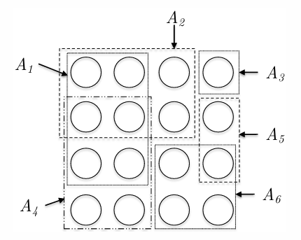
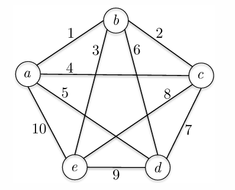
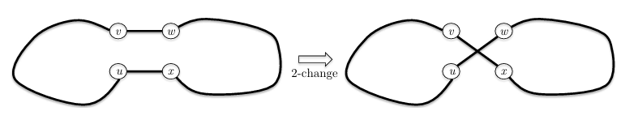
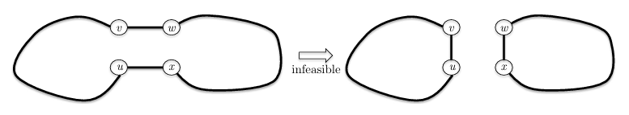
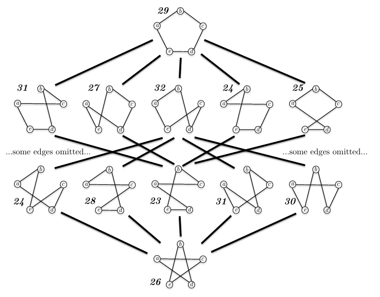

面对 NP-hard 问题，我们需要放弃正确性、通用性和速度中的某一方面，从而在实际应用中找到可行的解决方案。当通用性和速度都是关键需求时，可以考虑不总是正确的启发式算法，目标是尽可能降低损失、尽量接近最优解，好处是算法既通用又高效。下面看几个例子。

## 最小化完工时间
在调度问题中，待完成的任务通常称为作业（`job`），资源称为机器（`machine`）。一个调度方案（`schedule`）为每个作业指定一台机器来处理它。假定每个作业 $j$ 都有一个已知长度 $\ell_j$，即完成它的时间。最常见的目标就是要尽快完成这些作业。这里需要量化的事情是：

- 一个调度方案中某台机器的负载（`load`）是分配给它的所有作业长度之和。
- 一个调度方案的完工时间（`makespan`）是所有机器负载中的最大值。

无论作业在每台机器上以什么顺序执行，负载和完工时间都不变，因此我们的调度方案只需指定作业到机器的分配，而不指定作业的执行顺序。

有了上述约定，最小化完工时间问题可以定义为：给定 $n$ 个长度为正的作业 $\ell_1,\ell_2,\dots,\ell_n$，以及 $m$ 台机器，求一个作业到机器的分配，使得完工时间最小。

最小化完工时间是一个 NP-hard 问题，这里要找到一个高效、通用且几乎正确的算法。

不管是容易问题还是困难问题，[贪心算法](../DesignParadigm.md#贪心算法)都是一个好的开始。贪心算法的优势是容易想出来，而且往往非常快；缺点是可能在某些输入上返回错误结果，这与我们的要求相当契合。

对于这个问题，一个朴素的想法就是逐个把作业分配给各个机器，由于我们希望调度尽可能平衡，因此我们把作业分配给当前负载最小的机器。这个贪心算法称为 Graham 算法。算法的伪代码如下：
```
for i in [1, m]
    J_i = {}        // jobs assigned to machine i
    L_i = 0         // load of machine i

for j in [1, n]
    k = argmin_{i=1}^m L_i      // find index of machine with minimum load
    J_k = J_k + {j}             // assign job j to machine k
    L_k = L_k + l_j             // update load of machine k

return J_1, J_2, ..., J_m
```
第二个 `for` 循环一共 `n` 次，其中 `argmin` 操作需要扫描所有 `m` 台机器，因此算法的时间复杂度为 $O(nm)$。这里可以使用堆来提升效率，将 `argmin` 操作的时间复杂度从 $O(m)$ 降低到 $O(\log m)$，从而使整体时间复杂度降为 $O(n \log m)$。

下面分析这个算法是不是足够好，或者说距离最佳解有多远。设最优解的完工时间为 $M^*$，即最优调度方案中负载最大的机器的负载。设贪心算法得到的完工时间为 $M$。我们希望找到 $M$ 与 $M^*$ 之间的关系。

首先，任意调度方案的完工时间都不会小于所有作业长度之和除以机器数，因此
$$M^*\geq \frac{1}{m}\sum_{j=1}^n \ell_j$$
另外，最优解的完工时间不会小于任意一个作业的长度，因此对任意作业 $j$ 均有
$$M^*\geq\ell_j$$
令 $i$ 是贪心算法得到的调度方案中负载最高的机器，负载是 $L_i$，最后一个分配给机器 $i$ 的作业为 $j$，长度为 $\ell_j$。在分配作业 $j$ 之前，机器 $i$ 的负载为 $L_i-\ell_j$。由于贪心算法总是把作业分配给当前负载最小的机器，因此在分配作业 $j$ 时，所有机器的负载都不小于 $L_i-\ell_j$。因此有
$$L_i-\ell_j \leq \frac{1}{m}\sum_{h=1}^{j-1} \ell_h$$
右边的求和没有包含所有作业，将它扩充到 $j+1,j+2,\dots,n$，可以得到
$$L_i-\ell_j \leq \frac{1}{m}\sum_{h\neq j} \ell_h$$
因此
$$M\leq\ell_j +\frac{1}{m}\sum_{h\neq j} \ell_h=\left(1-\frac{1}{m}\right)\ell_j + \frac{1}{m}\sum_{h=1}^n \ell_h$$
利用之前得到的下界 $M^*\geq\frac{1}{m}\sum_{j=1}^n \ell_j$ 和 $M^*\geq \ell_j$，可以得到
$$M\leq\left(1-\frac{1}{m}\right)M^* + M^* = \left(2-\frac{1}{m}\right)M^*$$
也就是说贪心算法得到的完工时间至多是最优解的 $\left(2-\frac{1}{m}\right)$ 倍，接近两倍，是一个可以接受的结果。

能做到更好吗？Graham 给出了另一种解法。优先考虑较长的作业，即先将作业按长度从大到小排序，然后再使用贪心算法分配作业。这种方法称为最长处理时间优先（`longest processing time first`, `LPT`）。

排序的时间复杂度是 $O(n\log n)$，然后使用贪心算法分配作业，时间复杂度是 $O(n\log m)$，因此整体时间复杂度为 $O(n\log n + n\log m) = O(n\log n)$（通常假定 $mW\le n$）。

LPT 算法的性能比普通贪心算法更好，Graham 证明了它的近似比为 $\frac{4}{3}-\frac{1}{3m}$，也就是说 LPT 算法得到的完工时间至多是最优解的 $\frac{4}{3}-\frac{1}{3m}$ 倍。下面证明一个稍弱的结论：至多是最优解的 $\frac{3}{2}-\frac{1}{2m}$ 倍。

同样令作业 $j$ 为最后一个分配给负载最高机器的作业。若作业 $j$ 属于最长的 $m$ 个作业（即 $j \le m$），则每台机器至多分配了一个作业，此时显然已是最优解；若作业 $j$ 不在最长的 $m$ 个作业之列，那么前 $m+1$ 个作业的长度都不小于 $\ell_j$。根据鸽巢原理，在任意调度方案中，这 $m+1$ 个作业里至少有两个被分配到同一台机器，因此这台机器的负载至少为 $2\ell_j$。所以
$$M^*\geq 2\ell_j$$
代入之前的公式可以得到
$$M\leq\left(1-\frac{1}{m}\right)\ell_j + \frac{1}{m}\sum_{h=1}^n \ell_h \leq \left(1-\frac{1}{m}\right)\frac{M^*}{2} + M^* = \left(\frac{3}{2}-\frac{1}{2m}\right)M^*$$

## 最大覆盖
最大覆盖（`maximum coverage`）问题是一个 NP-hard 问题，输入由基集（`ground set`） $U$ 的 $m$ 个子集 $A_1,A_2,\dots,A_m$ 以及一个预算 $k$ 组成。目标是选择 $k$ 个子集，使它们的覆盖最大，即它们并集包含的不同基集元素的个数最多。

例如一个团队招聘，候选人有各种技能，每个候选人掌握的技能可以看作一个子集。我们希望在有限的招聘名额下，选择一组候选人，使团队掌握的技能尽可能多。

再比如下面的例子，基集有 16 个元素，从六个子集中选择四个，选择 $A_2,A_4,A_5,A_6$ 可以覆盖最多的元素，共计 15 个。



我们仍旧可以使用贪心算法来求解最大覆盖问题。当 $k=1$ 时，问题很容易，选择最大的集合即可。当 $k=2$ 时，如果我们已经选定了最大的子集 $A$，第二个子集需要选择能够覆盖最多新元素的子集，而新元素就是 $A$ 没有覆盖的元素。把这个想法推广到任意 $k$，就得到最大覆盖问题的贪心算法：每次选择能够覆盖最多新元素的子集，直到选满 $k$ 个子集。

```text
K = {}      // selected set indices
for j = 1 to k
    i* = argmax_{i=1}^m [f_cov(K + {i}) - f_cov(K)]   // find the set that covers the most new elements
    K = K + {i*}                                       // add it to the selected sets

return K
```

这个贪心算法足够好吗？下面证明它至少能够达到最优解的 $1-\left(1-\frac{1}{k}\right)^k$ 倍。

首先给出一个引理：令 $C_j$ 为算法选择前 $j$ 个子集后覆盖的元素数（$j\in\{1,2,\dots,k\}$），$C^*$ 是最大覆盖，即最优解对应的覆盖元素数。对于每一个 $j$，第 $j$ 个被选择的子集能够覆盖的新增元素数至少为 $\frac{C^* - C_{j-1}}{k}$，即
$$C_j-C_{j-1}\geq\frac{1}{k}\left(C^* - C_{j-1}\right)$$

令 $K_{j-1}$ 表示算法选择前 $j-1$ 个子集的索引，那么 $C_{j-1}=f_{\mathrm{cov}}(K_{j-1})$。对于任意一个包含 $k$ 个索引的集合 $\hat{K}$，记其覆盖为 $\hat{C}=f_{\mathrm{cov}}(\hat{K})$。

令 $W$ 表示被 $\hat{K}$ 覆盖但未被 $K_{j-1}$ 覆盖的元素集合。这里用 $\hat{S}$ 和 $S_{j-1}$ 分别表示 $\hat{K}$ 和 $K_{j-1}$ 覆盖的元素集合，那么 $|\hat{S}|=\hat{C}, |S_{j-1}|=C_{j-1}$。因此
$$W =\hat{S}\setminus S_{j-1}$$
那么
$$
|W|=|\hat S|-|\hat S\cap S_{j-1}|=\hat C-|\hat S\cap S_{j-1}|.
$$
又因为 $\hat S\cap S_{j-1}\subseteq S_{j-1}$，所以
$$|\hat S\cap S_{j-1}|\le |S_{j-1}|=C_{j-1}$$
因此
$$|W|\ge \hat C - C_{j-1}$$

求和 $\sum_{i\in\hat K}\left[f_{\mathrm{cov}}(K_{j-1} + \{i\}) - f_{\mathrm{cov}}(K_{j-1})\right]$ 表示对 $\hat K$ 中的每一个索引 $i$，计算把子集 $A_i$ 加入当前选择的 $K_{j-1}$ 后新增覆盖的元素数。由于这些子集覆盖了 $W$ 中的所有元素一次或多次，因此
$$\sum_{i\in\hat K}\left[f_{\mathrm{cov}}(K_{j-1} + \{i\}) - f_{\mathrm{cov}}(K_{j-1})\right] \ge |W|$$
即
$$\sum_{i\in\hat K}\left[f_{\mathrm{cov}}(K_{j-1} + \{i\}) - C_{j-1}\right] \ge |W|$$
结合之前的不等式 $|W|\ge \hat C - C_{j-1}$，得到
$$\sum_{i\in\hat K}\left[f_{\mathrm{cov}}(K_{j-1} + \{i\}) - C_{j-1}\right] \ge \hat C - C_{j-1}$$
上式左端共有 $k$ 项，它们的和大于等于右端，因此最大的一项不小于它们的平均值，即
$$\max_{i\in\hat K}\left[f_{\mathrm{cov}}(K_{j-1} + \{i\}) - C_{j-1}\right] \ge \frac{1}{k}\left(\hat C - C_{j-1}\right)$$
由于 $\hat{K}$ 可以是任意一个包含 $k$ 个索引的集合，把它换成最优解 $K^*$，对应的覆盖为 $C^*$，得到
$$\max_{i\in K^*}\left[f_{\mathrm{cov}}(K_{j-1} + \{i\}) - C_{j-1}\right] \ge \frac{1}{k}\left(C^* - C_{j-1}\right)$$
由于贪心算法选择的第 $j$ 个子集正是使得 $f_{\mathrm{cov}}(K_{j-1} + \{i\}) - C_{j-1}$ 最大的子集，因此覆盖至少可以增加 $\frac{1}{k}\left(C^* - C_{j-1}\right)$。

有了这个引理，我们倒着推导，先令 $j=k$ 得到
$$C_k\ge C_{k-1} + \frac{1}{k}\left(C^* - C_{k-1}\right)=\frac{C^*}{k} + \left(1-\frac{1}{k}\right)C_{k-1}$$
同理，令 $j=k-1$，得到
$$C_{k-1}\ge C_{k-2} + \frac{1}{k}\left(C^* - C_{k-2}\right)=\frac{C^*}{k} + \left(1-\frac{1}{k}\right)C_{k-2}$$

将其代入 $C_k$ 的不等式，得到
$$C_k\ge \frac{C^*}{k} + \left(1-\frac{1}{k}\right)\left[\frac{C^*}{k} + \left(1-\frac{1}{k}\right)C_{k-2}\right] = \frac{C^*}{k} + \frac{C^*}{k}\left(1-\frac{1}{k}\right) + \left(1-\frac{1}{k}\right)^2 C_{k-2}$$

继续递推，结合 $C_0=0$，最终得到
$$C_k\ge \frac{C^*}{k}\sum_{i=0}^{k-1}\left(1-\frac{1}{k}\right)^i = C^*\left[1-\left(1-\frac{1}{k}\right)^k\right]$$

当 $k$ 较小时，贪心算法的近似比更高，例如：
- $k=1$ 时，$1-(1-1)^1 = 1$，算法直接选出最大的子集，就是最优解；
- $k=2$ 时，$1-(1-1/2)^2 = 75\%$，算法至少能达到最优解的 75%。

自然常数 $e$ 的极限公式是
$$e=\lim_{k\to\infty}\left(1+\frac{1}{k}\right)^k$$
因此
$$\lim_{k\to\infty}\left(1-\frac{1}{k}\right)^k = \frac{1}{e}$$
随着 $k$ 的增大，该下界单调递减并趋于极限：
$$C_k \ge C^*\left(1-\frac{1}{e}\right)$$
也就是说，即使在 $k$ 很大的最坏情况下，贪心算法覆盖的元素数也能达到最优解的 $1-\frac{1}{e}\approx 63.2\%$ 左右。

## 影响最大化
社交网络（`social network`）是一个有向图 $G=(V,E)$，其中顶点对应人，有向边 $(v,w)$ 表示 $v$ 对 $w$ 有影响力。

级联模型（`cascade model`）描述信息如何在社交网络中传播。一个简单的模型可以由有向图 $G=(V,E)$、激活概率 $p\in[0,1]$ 以及种子顶点集合 $S\subseteq V$ 来定义。初始时，每个种子顶点都是活跃的（`active`），其他所有顶点都是不活跃的（`inactive`）。所有的边都是未翻转的（`unflipped`）。只要还存在某个活跃的顶点 $v$ 和一条未翻转的出边 $(v,w)$，那么就抛一枚有偏硬币，以概率 $p$ 出现正面。如果硬币为正面，把边 $(v,w)$ 的状态更新为活跃。如果 $w$ 不活跃，那么它的状态也更新为活跃。若硬币为反面，则把边 $(v,w)$ 的状态更新为不活跃。一旦一个顶点被激活，就永远不会再变为不活跃的状态了。一个顶点可能有多次被激活的机会。

影响最大化（`influence maximization`）问题是指在社交网络中选择有限数量的种子顶点，使信息的传播范围最大，也就是按照级联模型最终被激活的顶点数量最大。这个数量是一个随机变量，取决于级联模型中硬币抛掷的结果，因此我们关注其期望值。令 $X(S)$ 表示当顶点集合 $S$ 是种子顶点时最终被激活的顶点集合，$S$ 的影响力（`influence`）是
$$f_{\mathrm{inf}}(S) = \mathbb{E}[|X(S)|]$$

一个集合的影响力既取决于图，也取决于激活概率；边越多、概率越大，影响力就越大。

有了上述定义，我们可以定义影响最大化问题。给定一个有向图 $G=(V,E)$、激活概率 $p\in[0,1]$ 以及正整数 $k$，影响最大化问题要求选择 $k$ 个顶点作为种子顶点，使得它们的影响力最大。换句话说，我们希望找到一个顶点集合 $S\subseteq V$，满足 $|S|=k$，使得 $f_{\mathrm{inf}}(S)$ 最大。

影响最大化问题与最大覆盖问题很相似，后者可以看作是前者的一个特例。我们这里也使用贪心算法来近似求解影响最大化问题。
```
S = {}          // selected seed vertices
for j in [1, k]
    v* = argmax_{v in V}[f_inf(S + {v})-f_inf(S)]
    S = S + {v*}
```
在包含 $n$ 个顶点、$m$ 条边的图上，`for` 循环 $k$ 次，`argmax` 要遍历所有顶点，因此 $f_{\mathrm{inf}}$ 需要计算 $kn$ 次。每次计算 $f_{\mathrm{inf}}$ 都需要遍历 $m$ 条边，同时为了计算期望值，还需要考虑 $2^m$ 种不同的边状态组合。因此时间复杂度是 $O(knm\cdot 2^m)$。这仍旧是一个指数算法。不过我们可以通过采样来近似 $f_{\mathrm{inf}}$ 的值，重复多次，得到的平均值是 $f_{\mathrm{inf}}(S)$ 的一个很好的近似。

给定有向图 $G=(V,E)$、激活概率 $p\in[0,1]$ 和正整数 $k$。为简化起见，我们对级联模型做一个后处理：对未翻转的边按照概率 $p$ 处理一次，将其转化为活跃或者不活跃的状态，但不更新顶点的状态。种子 $S$ 激活的顶点集合 $X(S)$ 恰好是从 $S$ 中的顶点出发、沿着活跃边构成的有向路径可达的顶点组成的集合。

假定某次后处理后，活跃边的集合为 $H\subseteq E$，那么影响最大化问题可以归约为最大覆盖问题。基集是顶点集 $V$，集合 $A_{v,H}$ 包含从 $v$ 出发、沿着活跃边子图 $(V,H)$ 中的有向路径可达的顶点。那么
$$f_H(S)=\left|\bigcup_{v\in S}A_{v,H}\right|$$
我们无法预先知道活跃边的子集，但是每个子集 $H\subseteq E$ 出现的概率是
$$p_H=p^{|H|}(1-p)^{|E|-|H|}$$
因此，影响力可以表示为覆盖函数的加权平均：
$$f_{\mathrm{inf}}(S) = \sum_{H\subseteq E} p_H \cdot f_H(S)$$
和最大覆盖问题类似，对每个 $j\in\{1,2,\dots,k\}$，令 $I_j$ 表示算法选择的前 $j$ 个顶点所获得的影响力。对于每一个 $j$，第 $j$ 个被选择的顶点至少使影响力增加 $\frac{1}{k}(I^*-I_{j-1})$，其中 $I^*$ 表示 $k$ 个顶点的最大可能影响力：
$$I_j-I_{j-1}\ge\frac{1}{k}\left(I^*-I_{j-1}\right)$$
利用之前的方法可以证明这一点。进而可知，这个贪心算法输出的解的影响力总是至少达到最大可能影响力的 $1-\left(1-\frac{1}{k}\right)^k$。随着 $k$ 的增大，该比例趋近于 $1-\frac{1}{e}\approx 63.2\%$。

## 针对 TSP 的 2-OPT 启发式算法
回顾一下旅行商问题（`Traveling Salesman Problem`, `TSP`）：给定一个边成本为实数的完全图 $G=(V,E)$，目标是找到一条巡回，恰好访问每个顶点一次，最后回到起点，并使边成本之和最小。这是一个 NP-hard 问题，我们先从贪心算法开始尝试求解。

最近邻启发式算法（`nearest neighbor heuristic algorithm`）从某个顶点出发，重复以下步骤直到所有顶点都被访问：如果当前顶点是 $v$，就前往最近的未访问顶点 $w$（即 $c_{vw}$ 最小的顶点）。最后回到起始顶点。

比如下面这个例子，我们从 $a$ 开始，$b,c,d,e$ 都还没有被访问，选择成本最小的边 $(a,b)$。接着从 $b$ 出发，选择 $(b,c)$，依次下去，回到顶点 $a$。最近邻算法给出的巡回是 $abcde$，成本是 29。不过在这个图上可以穷举所有巡回，最优巡回的成本是 23，对应的路线是 $acbed$。由此可见，最近邻启发式算法并不能构造出成本最小的巡回。让人更不安的是，假定 $(a,e)$ 之间的成本变得相当大，那么最近邻算法可能会选择一条非常糟糕的巡回，成本可能比最优巡回的成本大任意倍数。



下面我们尝试改进最近邻算法。在 $n$ 个顶点的巡回中，一共有 $n$ 条边，如下图所示，两条不同的巡回之间最多可能有 $n-2$ 条边相同。



我们在巡回中找到不共享端点的边 $(v,w)$ 和 $(u,x)$，将这两条边移除，并加入另一对边 $(v,x)$ 和 $(u,w)$，得到一条新的巡回。

两条边共有四个不同端点时，重新配对一共有三种方式。除了原有的配对和上述 2-交换，还有下面这一种，不过这种配对会产生两个不相交的环而不是巡回，因此不是一个可行的交换。



因此，从已有的一条巡回中选出两条不共享端点的边，只有一种交换方式能得到新的巡回，这种交换称为 2-交换（`2-change`）。

一次 2-交换可能使巡回变得更差，也可能变得更好，这取决于 $c_{vw}+c_{ux}$ 和 $c_{vx}+c_{uw}$ 的大小关系。如果 $c_{vx}+c_{uw} < c_{vw}+c_{ux}$，那么交换会降低巡回的总成本，从而改进巡回。

对于 $n$ 个顶点的巡回，有 $n$ 条边，第一次选择一条，有 $n$ 种选法，第二次选择不共享端点的边，有 $n-3$ 种选法，总共有 $n(n-3)/2$ 种不同的 2-交换方式。

2-OPT 算法就是利用这种 2-交换来改进初始巡回的启发式算法。具体做法是：使用最近邻启发式算法得到一个初始巡回，然后不断尝试所有可能的 2-交换，如果某个 2-交换能够降低巡回的总成本，就执行该交换。重复这一过程，直到没有任何 2-交换能够进一步改进巡回为止。

回到上面的例子中，最开始我们使用最近邻启发式算法得到的初始巡回是 $abcde$，成本是 29。然后我们尝试所有可能的 2-交换，交换边 $(a,b)$ 和 $(d,e)$，替换为 $(a,d)$ 和 $(b,e)$，得到新的巡回 $adcbe$，成本是 27。再继续尝试 2-交换，将 $(a,e)$ 和 $(b,c)$ 替换为 $(a,b)$ 和 $(c,e)$，巡回成本降到 24。此时没有可改进的 2-交换了，算法停止。

2-OPT 算法的复杂度主要由主循环的迭代次数和每次迭代执行的操作数决定。对于 $n$ 个顶点，每次迭代有 $O(n^2)$ 个可能的 2-交换需要检查，因此每次迭代的时间上界是 $O(n^2)$。但是迭代次数不可控：尽管 2-OPT 每次迭代后巡回的成本都会严格小于上一次，最差情况下仍可能执行指数级次数的迭代，遍历大量可能的巡回。不过好消息是，对于现实中出现的输入，2-OPT 几乎总是能在合理的迭代次数内停止，通常只需亚二次（`subquadratic`）次迭代。另外，算法始终维护着一条可行的巡回，因此它可以在任何时候被中断，并返回当前找到的最优结果。

2-OPT 算法只是在初始巡回的基础上进行改进，并不能保证找到最优解，比如上面的例子找到了成本是 24 的巡回，而最优巡回的成本是 23。对于更复杂、更刻意构造的例子，2-OPT 算法返回的巡回成本可能比最优巡回的成本大任意倍数。也就是说，它没法像之前讨论的最大覆盖、最小化完工时间等问题那样获得近似比保证。不过对于实践中出现的实例，2-OPT 算法通常能够找到接近最优的巡回。

最近邻启发式算法和 2-OPT 算法的实现可以参考：https://github.com/shenlei149/algorithms-data-structures/blob/main/src/graph/TravelingSalesman.h

## 局部搜索原理
局部搜索算法在可行解空间中探索，进行局部移动来逐步改进目标函数。TSP 中的 2-OPT 就是一个典型的例子，其中 2-交换作为局部移动，用于不断改进当前巡回的总成本。

对于边权重为实数的 TSP 输入图 $G=(V,E)$，可以将 2-OPT 算法视为一种局部搜索算法，在可行解的元图（`meta-graph`）$H=(X,F)$ 上进行贪心搜索。$G$ 的每条巡回 $x$ 是 $H$ 的一个顶点，即 $x\in X$，每个顶点有一个标签表示其成本。如果 $H$ 中两个顶点对应的巡回在 $G$ 中可以通过一次 2-交换相互转换，那么这两个顶点之间就有一条边 $(x,y)\in F$。下面的图就是之前例子中巡回的元图表示，其中每个顶点对应一个巡回，边表示两个巡回可以通过一次 2-交换相互转换。2-OPT 从最上层的顶点出发，前进到第二行的第二个巡回，然后到第三行的第一个巡回，此时它的成本不高于任何邻居，是一个局部最优解，算法停止。



大多数局部搜索算法都可以类似地看作是在可行解元图上进行贪心搜索。甚至可以把可行解空间在三维中表示出来，用高度表示目标函数值，从而直观地看到算法如何沿着目标函数下降的方向前进，直到达到局部最优。梯度下降（`gradient descent`）就是这样一个变体，用于连续优化，在现代机器学习中被广泛使用。

局部搜索算法的范式可以包含以下几个步骤：

1. 定义可行解，即定义元图的顶点
2. 定义目标函数，即定义元图顶点的数值标签的计算方式
3. 定义局部移动，即定义元图的边
4. 决定如何选择初始可行解，即元图上的起始顶点
5. 决定如何在多个改进的局部移动之间选择
6. 执行局部搜索，从初始可行解出发，通过局部移动反复改进目标函数值，达到局部最优解（`local optimum`）

上述范式的前三步是建模决策，第 4、5 步是算法决策（第 6 步为执行过程）。我们先来分析前者。

第一步是定义可行解。在 TSP 问题中，$n$ 个顶点的可行解有 $\frac{1}{2}(n-1)!$ 条不同的巡回。在最小化完工时间问题中，$m$ 台机器、$n$ 个作业，可行解是所有作业到机器的分配，有 $m^n$ 种不同的方式。在最大覆盖问题中，从 $m$ 个子集中选择 $k$ 个，可行解有 $\binom{m}{k}$ 种不同的方式。

第二步是定义目标函数。在 TSP 问题中，目标函数是巡回的总成本。在最小化完工时间问题中，目标函数是所有作业的完工时间的最大值。在最大覆盖问题中，目标函数是所选子集覆盖的元素数量。

第三步是定义允许的局部移动。在 TSP 问题中，局部移动是 2-交换，$n$ 个顶点的巡回有 $n(n-3)/2$ 种不同的 2-交换方式。在最小化完工时间问题中，局部移动可以是把一个作业重新分配给另一台机器，此时有 $n(m-1)$ 种不同的局部移动方式。在最大覆盖问题中，局部移动可以是用一个未选的子集替换掉一个已选的子集，此时有 $k(m-k)$ 种不同的局部移动方式。局部移动的数量称为邻域大小（`neighborhood size`）。

当第 1-3 步完成后，元图就确定了，局部最优解也就确定了，即目标函数值不劣于任何邻居的元图顶点。不过第三步的决策并不是唯一的，也就是怎么连线（局部移动的定义）会影响局部最优解的分布和数量。不同的局部移动策略可能导致不同的局部最优解，从而影响局部搜索算法的性能。比如 TSP 的 3-交换邻域，也就是用三条不同的边替换巡回中的三条边，从而产生一个新的巡回。3-交换使得邻域变大，局部移动的可能性也更多，局部搜索算法可能找到更好的局部最优解。缺点是每次改进的计算代价更高，因为每次需要检查的可能交换更多。

第四步决定如何选择初始的可行解。选择初始解可以使用贪心算法，也可以随机产生一个解。比如在 TSP 问题中，初始巡回可以使用最近邻算法构造，也可以均匀随机地生成一个顶点访问顺序。在最小化完工时间问题中，初始调度方案可以由 Graham 算法构造，也可以把每个作业独立地均匀随机分配给一台机器。在最大覆盖问题中，初始解可以是贪心算法给出的，也可以是均匀随机选择的 $k$ 个子集。

为什么要抛弃一个足够好的贪心启发式算法给出的结果呢？因为从更好的初始解出发进行局部搜索，并不一定能够得到更好的局部最优解。理想的初始化过程是快速给出一个不太差、同时又为局部改进留下大量机会的解。随机初始化通常符合这个要求。

第五步决定如何在多个改进的局部移动之间选择。最简单的方法就是逐个枚举，找到一个改进的就使用它。第二个方法是在每次迭代中考察所有可能的局部移动，选择改进最大的那个。第三个方法是随机选择一个改进的局部移动。

低质量的局部最优解会影响局部搜索的效果，如何避免呢？一种方法是增大邻域，使得每个解的邻居更多，从而增加找到更好局部最优解的机会。另一种方法是引入随机化，例如随机选择初始解，或者在每次迭代中随机选择一个改进的局部移动。还可以运行多次独立试验，返回所有试验中找到的最好局部最优解。

还有一种激进的方式是允许非改进的局部移动。比如迭代的思路如下：

1. 均匀随机地选择一个局部移动
2. 如果是改进的，就执行
3. 如果目标函数变差了 $\Delta>0$，就以一个随 $\Delta$ 递减的概率 $p(\Delta)$ 执行它，否则什么都不做。常用的概率函数是指数函数 $e^{-\Delta/\varepsilon}$，其中 $\varepsilon>0$ 是可调参数。

这种方法的一个著名实例是模拟退火算法（`simulated annealing`），它通过允许非改进的移动，增加了跳出局部最优解的机会，从而有可能找到更好的全局最优解。

同时，还可以叠加下面两个思想。

1. 依赖历史的邻域。允许的局部移动不是固定的，而是依赖于算法之前的轨迹。比如可以禁止那些看起来会部分逆转上一步的局部移动。
2. 维护一个解的集合。算法维护 $k\ge 2$ 个可行解而不是一个。每次迭代可以从 $k$ 个旧解的所有邻居中，选择 $k$ 个新的解，替换掉旧的解集合，这就是束搜索（`beam search`）。另一个思路是把 $k$ 个旧解和 $k$ 个新解两两组合，生成新的候选解，这大致是遗传算法（`genetic algorithm`）的思路。

当可行解只有有限多个时，局部搜索一定会停止，但是无法保证在多项式时间内停止。在实践中，几乎总是可以在可容忍的迭代次数内停止，并返回一个高质量的局部最优解，但是不能保证局部最优解一定接近最优解。整个算法可以在任意时刻被中断，并返回最后找到的解，它也是当前最好的解。
