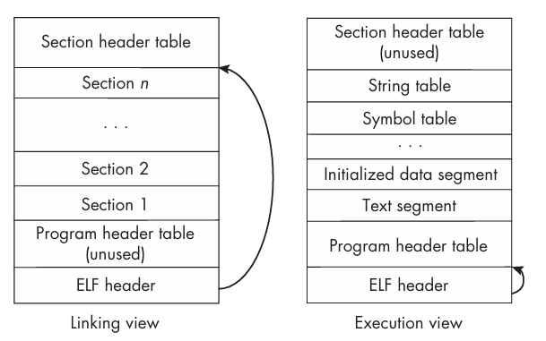
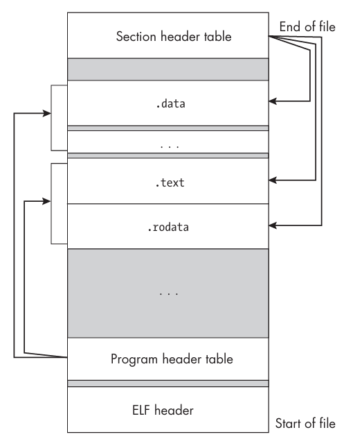
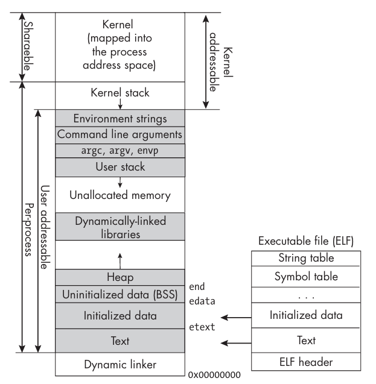

本章会讨论进程（`process`），包括进程的创建、管理以及进程间通信等内容。我们可以从普通非特权用户和内核两个角度来看待和理解进程。

## 进程及其相关概念
传统上，进程定义为正在运行的程序的一个实例。另一种理解进程的方式是把进程看作程序的实体，只要它还活着，就在执行某个程序，而这个程序可能并不是进程初始化时执行的那个程序了。POSIX 给出的定义为“一个地址空间，其中有一个或多个线程在该地址空间中执行，以及这些线程所需要的系统资源。”如果把进程看作是地址空间，其中某个东西正在执行，那么就不难接受它执行的内容是可以改变的，并且进程并不绑定某个特定的程序。

为了执行程序，进程需要物理内存来存放程序的指令和数据，还需要其他系统资源，比如磁盘和对 CPU 的特权访问。所有这些资源都是有限的，内核的职责就是在各个进程之间分配这些资源。为了决定哪个进程应该获得哪些资源，内核必须清楚地知道每个进程正在做什么。例如，它需要知道一个进程的调度优先级（`scheduling priority`）、它运行时的状态、任何挂起的定时器（`pending timers`）、已打开的文件描述符（`open file descriptors`）以及其他资源的使用情况。因此，内核需要一种进程的表示，包含它所管理的进程及其所需的所有信息。这些信息被称为进程元数据（`process metadata`），它们汇总到内核数据结构中，这个数据结构与创建时分配给它的唯一进程 ID（`process ID`, `PID`）相关联。

一般情况下知道了 `PID` 才能访问进程的元数据。`ps` `top` 这类命令会把 `PID` 和其他信息一起输出。有了 `PID`，我们还可以通过 `/proc` 伪文件系统访问进程的元数据。`/proc` 并不是通常意义上的文件系统，它是内核提供的一种接口。访问文件的普通命令和函数都可以访问进程的元数据。

在一个系统上，任意时刻都能找到几百个活动进程（`active processes`），或称为存活进程（`living processes`），它是指已经创建并且尚未终止的进程。

除了 `PID` 为 1 的 `init`（`systemd`）进程以外，所有进程都是由某个进程创建的，这个创建它的进程被称为父进程（`parent process`），而新创建的进程被称为子进程（`child process`），同一个进程创建的所有进程被称为兄弟进程（`sibling processes`）。当系统启动时，内核会创建 `init` 进程，然后它继续创建其他进程，这些进程又创建其他进程，如此继续，形成了一棵以 `init` 为根的进程树（`process tree`）。通过命令 `pstree` 可以显示这棵树。

现代系统引入了进程组（`process group`）的概念。引入它是为了简化终止一条管道的方式。比如我们在 `shell` 中输入
```bash
last | cut -d ' ' -f 1 | sort -u
```
系统会创建多个独立的进程来执行每个子命令，但是都会放到同一个进程组中。当用户使用键盘输入 `Ctrl+C` 终止管道时，信号会发送给整个进程组，从而终止所有相关进程。

POSIX 将进程组定义为一组进程，允许向相关进程发送信号。每个进程组都有一个唯一的正整数进程组 ID（`process group ID`, `PGID`）。任意时刻，每个进程恰好都属于一个进程组。进程的进程组 ID 称之为 `PGRP`，被设置为该进程所属的进程组的 `PGID`。也就是说，`PGID` 是进程组的 ID，而 `PGRP` 是进程所属的进程组的 ID。

当一个进程被创建时，会获取父进程的 `PGRP`，因此一开始就作为父进程所在的组的一部分执行。当用户在 `shell` 中创建一条管道时，会创建一个新的进程组，然后为每个可执行程序创建一个进程，并将它们加入到这个新的进程组中。这样，当用户发送终止信号时，整个进程组都会收到信号，从而实现对管道中所有进程的统一管理。

下面一组系统调用可以获取或者设置进程的进程组信息，相关手册已经说明不推荐使用 BSD 的版本。
```c
#include <sys/types.h>
#include <unistd.h>

int setpgid(pid_t pid, pid_t pgid);
pid_t getpgid(pid_t pid);
pid_t getpgrp(void);                 /* POSIX.1 version */
pid_t getpgrp(pid_t pid);            /* BSD version */
int setpgrp(void);                   /* System V version */
int setpgrp(pid_t pid, pid_t pgid);  /* BSD version */
```
`setpgid` 有以下四种用法来修改进程的 `PGRP`：
```c
setpgid(0, pgid)   /* Set the PGRP of the calling process to pgid. */
setpgid(pid, 0)    /* Set the PGRP of process pid to pid. */
setpgid(0, 0)      /* Set the PGRP of the calling process to its PID. */
setpgid(pid, pgid) /* Set the PGRP of process pid to pgid. */
```
其中最后一个用法允许一个进程把另一个进程加入到指定的进程组中，前提是两个进程在同一个会话中。

现代系统引入会话（`session`）这个概念以便支持作业控制。会话是一组进程组，每个进程组恰好属于一个会话。由于每个进程属于某个进程组，因此每个进程都属于一个会话。会话、进程组、进程可以看作是一个层次结构。每个进程都有一个唯一的会话 ID（`session ID`, `SID`），用于标识所属的会话。会话的主要目的是围绕控制终端来组织进程。用户登录时，内核会创建一个会话，把该用户的所有进程和进程组都放入这个会话中，并把会话与终端关联起来，作为该会话的控制终端。每个会话中有一个进程是会话首进程（`session leader`），它是唯一一个 `SID` 等于 `PID` 的进程。

任何不是进程组首进程的进程可以调用 `setsid()` 来脱离所在的会话。`setsid()` 会创建一个新的会话，其会话 ID 是调用进程的 `PID`，这个函数还会创建一个新的进程组，并将调用进程加入到该进程组中。最初，新会话没有控制终端，这意味着进程不会受到键盘中断的影响。守护进程（`daemon`）就是这样创建的，脱离了自己本来所属的会话，独立运行。如果进程并不打算作为守护进程，可以调用 `open()` 打开一个终端，并传入与该终端对应的设备文件，从而获得一个控制终端。

进程可以通过 `getsid()` 获取会话 ID。`getsid(0)` 返回的是调用进程的 `SID`，`getsid(pid)` 返回的是进程 `pid` 的 `SID`。调用者和进程 `pid` 必须属于同一个会话，否则会返回 -1。

进程组可以分成两种类型，一是前台组（`foreground group`），二是后台组（`background group`）。如果一个进程位于前台进程组，那么它被称为前台进程（`foreground process`），否则被称为后台进程（`background process`）。非正式地说，前台进程与终端相连，后台进程不与终端直接交互。每个会话可以包含多个进程组，但其中至多只有一个前台进程组，其他进程组必须是后台组。后台进程的数量没有限制。

当我们在 `shell` 中输入一条命令的时候，为执行这个命令创建的所有进程都处于前台。不过，当我们在命令后面加一个 `&` 时，命令会在后台执行，创建的进程会被放入后台进程组。命令被放到后台组，`shell` 会立即返回，后台作业继续运行，我们可以在前台继续工作。

前台进程和后台进程的区别主要在于它们与终端的关联。前台进程可以直接从终端读取输入，也可以向终端输出，而后台进程则无法直接与终端交互。如果后台进程试图从控制终端读取，内核会向它发送 `SIGTTIN` 信号，这会让进程停止，但不会终止它。如果试图向终端输出，内核会向它发送 `SIGTTOU` 信号，这个信号的默认行为是停止进程，不过许多 `shell` 会忽略该信号，允许后台进程向终端输出。另一个区别是，当在终端输入产生信号的组合键时，信号只会向前台进程组发送。比如输入 `Ctrl+C`，`SIGINT` 不会被发送给后台进程。不过依旧可以使用 `kill` 命令向后台进程组发送 `SIGINT`。

`SIGHUP` 信号会发给会话中的所有进程。这个信号通常是在终端连接由于某种原因断开时产生的。这种情况发生时，默认情况下这些进程都会被终止。当从终端注销时，`SIGHUP` 会被发送给所有后台进程，如果想运行一个后台作业，并希望它在注销后继续运行，可以使用 `nohup` 命令，这样运行的进程会忽略 `SIGHUP` 信号并继续运行。

## 程序文件
一个程序最初是源代码文件，通过编译和链接源代码文件来创建可执行文件。当我们发出运行该可执行文件的命令时，内核会创建一个进程，并为它分配执行代码所需要的所有资源。这意味着可执行文件中包含着足够的信息来创建这个进程，这就引出了两个问题：

- 可执行文件中包含的是什么信息，使得内核能够在内存中创建进程？
- 创建这个进程包含哪些步骤？

一个可执行程序文件包含足够的信息让内核创建进程映像，这要求它至少包含以下信息：

- 可执行的机器指令，称之为文本（`text`）
- 开始执行的机器指令的地址，称之为入口点（`entry point`）。一个程序文件中除了 `main()` 函数之外，还可能包含其他函数，入口点标识代码中的 `main()` 函数
- 重定位表（`relocation table`），用于程序被加载到内存运行时把未解析的符号连接到实际地址
- 字符串表（`string table`），包含程序中使用的各种字符串，例如变量名、字符串字面量和函数名，以及程序动态链接所需的字符串
- 程序使用的所有已经初始化的数据，比如字符串字面量和数值字面量等
- 程序运行时需要加载哪些动态库的信息，包括动态链接器（`dynamic linker`）的路径名，该链接器会在运行时把这些库链接到程序上

所有这些信息都必须以精确的方式组织起来，以便加载器、链接器和其他程序能够找到并解释它们。比如可以用 `file` 命令查看可执行文件的信息。
```bash
file /bin/bash
/bin/bash: ELF 64-bit LSB pie executable, x86-64, version 1 (SYSV), dynamically linked, interpreter /lib64/ld-linux-x86-64.so.2, BuildID[sha1]=c985fd65e3f02e7ac05fd31765cf873e0931af61, for GNU/Linux 3.2.0, stripped
```
各种程序之所以能够根据文件头中的信息来解析文件的格式，是因为它们都遵循一种标准。

默认情况下，`gcc` 编译器生成的文件名是 `a.out`，这是因为 `a.out` 是 `assembler output` 的缩写。很早之前这不仅仅是文件的名称，还是很多操作系统上二进制可执行文件的格式名称。现在它不再是格式名称了。1993 年，Unix 系统引入了一种更具可移植性和可扩展性的格式，称为可执行与链接格式（`executable and linkable format`, `ELF`）。`ELF` 格式被广泛采用，几乎所有现代的 Unix 系统都支持它。

ELF 规范 1.2 版本定义了以下四种不同类型的格式：

- 可重定位文件（`relocatable file`），存储适合与其他目标文件链接的代码和数据，以便创建可执行文件或共享目标文件
- 可执行文件（`executable file`），包含适合执行的程序，指定了如何构造进程映像
- 共享目标文件（`shared object file`），存储用于链接的代码和数据，适用于两种不同的情况：一是链接器把它和其他可重定位文件和共享目标文件一起处理，创建另一个共享目标文件；二是动态链接器把它和可执行文件以及其他共享目标文件一起处理，创建进程映像
- 核心文件（`core file`），由核心转储（`core dump`）创建，核心转储是进程内存映像写入文件的一份快照。某些信号未被处理时，如果系统配置允许，就会生成核心文件。

`ELF` 文件总是以 `ELF` 头（`ELF header`）开始，这个部分像是通往文件其余部分的索引，详细说明了文件的组织方式。它标识出访问文件其他组件所需的表信息，比如重定位表、字符串表、符号表等，并且提供了这些表的地址和大小。由于它被设计为同时用于程序的链接和执行，因此它内嵌了不同但并行、重叠的视图，分别称为链接视图（`linking view`）和执行视图（`execution view`）。



- 链接视图是链接器在链接和重定位文件中的组件时所需的文件视图。在这种视图中，文件被组织为节（`section`），每节包含链接所需的大部分信息，比如指令、数据、符号表、重定位信息等等。每个节都由一个节头（`section header`）描述，包含该节所含信息的类型、节的大小和位置等。所有节头组成了节头表（`section header table`）。
- 执行视图是用于加载和执行程序的视图。在这种视图中，文件被组织为段（`segment`），它是文件中被加载到内存形成进程内存映像的部分。它由一个或多个节组成。每个段由一个程序头（`program header`）描述，包含段的大小、位置、应加载到的虚拟地址等信息。所有程序头组成了程序头表（`program header table`）。

段和节是观察文件中完全相同数据的两种不同的方式。它们的区别不在于包含哪些数据，而在于如何引用和使用这些数据。如果存在程序头表，它告诉系统如何创建进程映像。用于构建进程映像的可执行程序文件必须包含程序头表，可重定位文件不需要。节头表包含描述文件各节的信息，每个节在表中都有一个条目（`entry`），每个条目给出了节名、大小等信息。链接期间使用的文件必须要有节头表，其他目标文件可以有也可以没有。

当可执行程序被加载到内存时，段不会被映射到物理地址（`physical address`），而是被映射到逻辑地址（`logical address`），逻辑地址也称为虚拟地址（`virtual address`）。CPU 在执行程序时生成的地址是逻辑地址，而物理地址是物理内存中的实际地址。比如一个进程生成了介于 `0x08048000` 和 `0xc0000000` 之间的逻辑地址，这并不意味着会访问从 `0x08048000` 到 `0xc0000000` 之间的物理内存。现代操作系统使用虚拟内存管理（`virtual memory management`）将逻辑地址映射到物理地址。

节头表和程序头表可以看作是结构体组成的数组。文件中的节和段不必位于特定位置，因为表里面会存储它们的位置和大小。如下图所示。这个图还说明了一个段可以由多个节组成，比如 `.text` 节和 `.rodata` 节属于同一个可加载段，该段由程序头表索引，这些节都是独立的节，由节头表索引。



ELF 文件的组织和结构可以参考相关的手册、规范。Linux 上可以使用 `readelf` 命令查看，下面是部分参数的含义：

- `-a` 显示几乎所有的内容
- `-a --use-dynamic` 显示所有内容
- `-e` 显示所有头
- `-h` 显示 ELF 文件头
- `-l` 显示所有程序头（段）
- `-S` 显示所有节头
- `-t` 显示节详情
- `-s` 显示所有符号

比如，我们编译经典的 `hello world` 程序，然后查看它的 ELF 文件头。开始的第一个字节是 `0x7f`，接着的三个字节是 `ELF`，后面是一些编码信息，比如文件类型、架构、版本等。
```bash
readelf -h hello_world
ELF Header:
  Magic:   7f 45 4c 46 02 01 01 00 00 00 00 00 00 00 00 00 
  Class:                             ELF64
  Data:                              2's complement, little endian
  Version:                           1 (current)
  OS/ABI:                            UNIX - System V
  ABI Version:                       0
  Type:                              DYN (Position-Independent Executable file)
  Machine:                           Advanced Micro Devices X86-64
  Version:                           0x1
  Entry point address:               0x1050
  Start of program headers:          64 (bytes into file)
  Start of section headers:          13968 (bytes into file)
  Flags:                             0x0
  Size of this header:               64 (bytes)
  Size of program headers:           56 (bytes)
  Number of program headers:         14
  Size of section headers:           64 (bytes)
  Number of section headers:         31
  Section header string table index: 30
```

## 虚拟内存布局
这一节分析一个进程在它的虚拟地址空间（`virtual address space`）中的布局。这里讨论的不是物理内存而是虚拟内存。虚拟内存的布局取决于体系结构，这里描述的是 `x86-64` 运行 Linux 时的典型布局。

进程的用户空间被分成了五个区域，其中四个被称为段（`segment`）。从最低地址到最高地址分别是：

- 文本段（`text segment`），包含可执行指令
- 已初始化数据段（`initialized data segment`）
- 未初始化数据段（`uninitialized data segment`）
- 堆（`heap`）
- 栈段（`stack segment`）

C 库定义了三个变量 `etext` `edata` `end`，它们的地址分别是文本段、已初始化数据段和未初始化数据段的结束地址，即之后的第一个地址。它们不属于任何标准不过大多数 Unix 系统都提供。程序可以通过声明为 `extern` 来使用它们。

下图展示了这些段以及进程空间的其他部分在逻辑内存中是如何组织的，以及它们与 `ELF` 文件各段之间的关系。低地址在底部。阴影部分标识当前已经分配且进程可以寻址的逻辑地址。文本段下面是动态链接器映射到进程虚拟内存中的区域，进程不能访问这个部分。当运行一个程序的时候，动态链接器先运行，建立自己的内部数据结构，以便创建进程所需的链接，在它把库加载并映射到进程空间之后，它才把控制权交给程序中的第一条指令。



栈和堆之间的区域没有被使用，如果进程在这个区域中生成一个地址就会触发异常。栈的底部包含指向命令行参数和环境变量字符串的指针。参数和字符串位于栈的上方，栈从上向下增长。

环境变量字符串上方的区域是内核映射到进程地址空间的部分。当进程在非特权模式下运行时，它是不能访问这块内存的。当它发起系统调用时，特权级别发生变化，它就可以访问其虚拟内存中的这一部分了。把内核映射到每个进程的地址空间中，可以简化系统调用的实现方式。这里面有一块是每个进程（`per process`）独有的部分，存放进程相关的元数据。

很早以前，这些区域各自的起始位置是固定的。比如文本段总是从 `0x08048000` 开始。不过由于库和可执行文件总是位于已知的位置，利用内存漏洞的攻击越来越多，Linux 内核引入了地址空间布局随机化（`address space layout randomization`, `ASLR`）技术，各个区域的相对位置保持不变，但不同区域的实际位置会进行随机的平移。为了支持 `ASLR`，编译器生成位置无关代码（`position-independent code`）。
