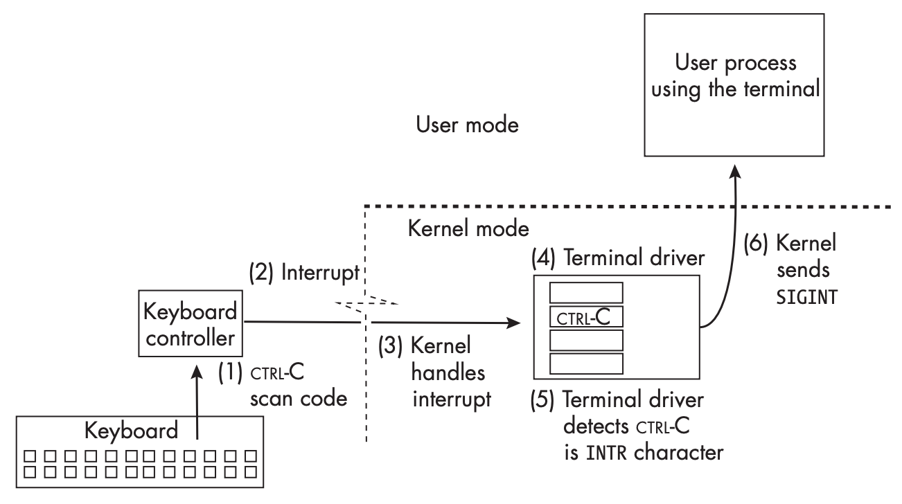
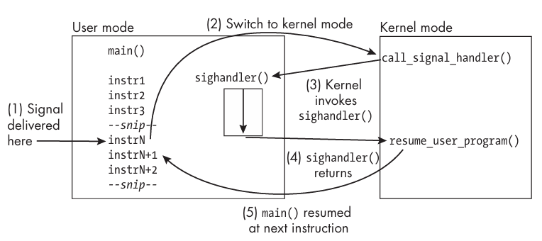

## 信号的作用
信号（`signal`）在 Unix 系统中是一种通知形式，用于向接收者告知某些重要的事件。在系统内部，信号本质上是软件中断，是发送给进程的空消息，中断其正常的指令周期。信号通常用于向进程报告异常情况，比如引用了无效内存地址（段错误）或终端断开了连接。许多信号和硬件中断类似，可以在任意时刻发生，且与进程在信号到达时所执行的指令无关。内核几乎是所有信号的来源。一个进程可以给另一个进程发送信号，或者向自身发送信号，这种情况下，信号会立即到达该进程。

发送信号的一个例子是在控制台按了 Ctrl+C，这些信号会在任意时刻发生，因此称为异步（`asynchronous`）信号。与此相对的是同步（`synchronous`）信号，它们是由程序本身的行为引起的，比如除零。

在 Unix 系统中，信号用唯一的一个整数表示，也是一个符号名。以 `SIG` 开头，后面跟一个描述目的的缩写。比如 `SIGINT` 表示中断信号，通常是由于用户按下 Ctrl+C 产生的，`SIGWINCH` 表示当前终端窗口大小发生变化时产生的信号。大多数架构体系中，`SIGINT` 都是 2，不过这并没有标准，因此在不同的系统中可能会有不同的值。除此之外，信号没有其他信息，因此信号也被称为信号类型（`signal type`）。

下面是一个信号发送给某个进程的例子。



当我们在键盘输入的时候，键盘内部会产生代表输入的扫描码（`scan code`），当按下 Ctrl+C 时，键盘会发送这个按键组合的扫描码到键盘控制器。控制器收到之后会产生一个硬件中断。每一次键盘敲击都会有硬件中断，因此可以处理每一个字符。内核会确定哪个终端与之关联，将控制权转交给终端驱动。终端驱动内部有一个字符数组，表示各种特殊字符（`special character`），特殊字符会触发其他操作，比如退格（`backspace`）。终端驱动确定这个字符在 `VINTR` 位置上，要发送中断信号（`SIGINT`）。驱动检查是否设置了特殊的标记位（`isig`），如果设置了，调用内核的信号子系统通知其向所有由该终端控制的进程发送 `SIGINT` 信号。内核把这个信号发送给所有的进程。如果进程没有特别处理，收到这个信号时会被终止。

信号的来源（`source`）是事件发生的组件，可以是软件也可以是硬件。不过只能由内核发送信号给进程，因此内核像是一个信号处理中心。

信号来源主要有以下几种：

* 用户：用户可以在任意时刻按键盘上的组合键来发送信号，比如 Ctrl+C、Ctrl+Z 等。用户可以执行 `kill` 命令来发送信号。这些信号可以发生在任意时刻，与进程运行到哪里无关，因此是异步信号。
* 内核：内核在 I/O 完成、定时器到期、网络断开等事件发生时会发送信号。内核会发送合适的信号来通知进程发生了什么事件。这些信号也是异步的。
* 硬件：一个进程可能会导致异常，比如浮点异常、非法指令、访问地址异常等等，这些大多数是由进程自身引起的，这些异常导致硬件陷阱，内核由于陷阱向进程发送信号。这些信号是同步的，因为如果再次运行程序，会在同样的地方再次发生异常。
* 其他进程：一个进程可以通过内核向另一个进程发送信号，前提是有这个权限。进程也可以向自身发送信号。

信号设计出来就是用于通知进程出现了某些事件，通常是错误和异常。

## 信号的概念
信号的生命周期从硬件或软件产生了事件或异常开始，到进程处理了这个信号为止。从内核的角度看，直到内核执行某个动作产生信号，信号才存在。产生信号的并不是事件本身，而是内核执行某个动作。Linux 内核检测到这些信息之后会修改目标进程的某些数据结构，这是一个信号队列，后续分析进程的时候会继续讨论。

如果发送信号的时候进程不在运行，那么进程并不会收到这个信号。在进程恢复运行且信号到达之前，该信号是挂起（`pending`）的状态。对每个进程而言，每种信号只能有一个挂起的实例，如果同一信号多次发送，那么只有第一次会被记录，后续的发送会被丢弃。进程可以通过设置信号掩码来屏蔽某些信号，在这种情况下，信号会被挂起，直到进程解除屏蔽。

当进程以下面某种形式对信号做出了响应，我们称信号已送达（`delivered`）：

* 进程显式地忽略了这个信号。
* 进程执行了信号处理函数。这种情况称之为信号被捕获（`caught`）了。
* 进程接受了该信号默认的行为，比如终止（`terminate`）、忽略（`ignore`）、停止（`stop`）（此时进程挂起，可以恢复运行）、继续（`continue`）、核心转储（`core dump`）等。

信号处理函数是特定形式的函数，注册（`register`）到内核中，当信号到达时会被调用。如果没有注册，也没有显式地告诉内核要忽略这个信号，那么内核会执行该信号的默认行为。

下表列举了常用的信号及其默认行为，默认行为一列中，Term 是终止（`terminate`）的缩写，Core 是 `core dump` 的缩写。使用 `kill -l` 或 `trap -l` 可以查看完整的信号清单。

| Name | Number | POSIX | Default action | Comment |
|------|--------|-------|----------------|---------|
| SIGHUP | 1 | Yes | Term | Hangup detected on controlling terminal or death of controlling process |
| SIGINT | 2 | Yes | Term | Interrupt from keyboard |
| SIGQUIT | 3 | Yes | Core | Quit from keyboard |
| SIGILL | 4 | Yes | Core | Illegal instruction |
| SIGTRAP | 5 | Yes | Core | Trace/breakpoint trap |
| SIGABRT | 6 | Yes | Core | Abort signal from abort(3) |
| SIGBUS | 7 | Yes | Core | Bus error (bad memory access) |
| SIGFPE | 8 | Yes | Core | Floating-point exception |
| SIGKILL | 9 | Yes | Term | Kill signal |
| SIGUSR1 | 10 | Yes | Term | User-defined signal 1 |
| SIGSEGV | 11 | Yes | Core | Invalid memory reference |
| SIGUSR2 | 12 | Yes | Term | User-defined signal 2 |
| SIGPIPE | 13 | Yes | Term | Broken pipe; write to pipe with no readers |
| SIGALRM | 14 | Yes | Term | Timer signal from alarm(2) |
| SIGTERM | 15 | Yes | Term | Termination signal |
| SIGCHLD | 17 | Yes | Ignore | Child stopped or terminated |
| SIGCONT | 18 | Yes | Cont | Continue if stopped |
| SIGSTOP | 19 | Yes | Stop | Stop process |
| SIGTSTP | 20 | Yes | Stop | Stop typed at terminal |
| SIGTTIN | 21 | Yes | Stop | Terminal input for background process |
| SIGTTOU | 22 | Yes | Stop | Terminal output for background process |
| SIGXCPU | 24 | Yes | Core | CPU time limit exceeded (4.2BSD) |
| SIGXFSZ | 25 | Yes | Core | File size limit exceeded (4.2BSD) |
| SIGVTALRM | 26 | Yes | Term | Virtual alarm clock (4.2BSD) |
| SIGPROF | 27 | Yes | Term | Profiling timer expired |
| SIGWINCH | 28 | No | Ignore | Window resize signal (4.3BSD, Sun) |
| SIGIO | 29 | No | Term | I/O now possible (4.2BSD) |
| SIGPOLL | 29 | Yes | Term | Pollable event (SystemV); synonym for SIGIO |
| SIGPWR | 30 | No | Term | Power failure (SystemV) |
| SIGSYS | 31 | Yes | Core | Bad system call (SVR4) |

这些信号名字源自英文单词，但是省略了部分字母。下面对这些信号进行分类。有的时候我们需要知道信号的总数，`signal.h` 头文件中定义了 `NSIG`，表示信号的总数。由于信号编号是连续分配的，因此 `NSIG` 是已定义的最高信号编号加一。

当程序遇到以下任意错误时，通常应该终止。这些信号是在程序发生了严重错误以至于无法继续运行时发出的。信号的目的是让程序在退出之前有机会进行清理操作。例如，它可能改变了终端窗口的状态，因而需要在退出之前恢复这些状态。清理完毕之后，程序就可以安全地终止了。

- `SIGABRT` 进程可以调用 `abort()` 函数来产生该信号。由于这个信号默认会产生核心转储（`core dump`），因此这是进程通过核心转储方式终止的一种途径。
- `SIGSEGV` 程序试图访问无权访问的内存部分，导致段错误（`segmentation fault`）。这通常发生在程序对未初始化的指针进行解引用，或者使用指针遍历数组但未检查数组边界的时候。
- `SIGBUS` 类似于 `SIGSEGV`，不同之处在于它是程序试图访问无效内存地址时产生的，引发了总线错误（`bus error`）。
- `SIGFPE` 出现了算术错误，不仅仅是浮点数错误，还包括除以零和溢出等错误。
- `SIGILL` `ILL` 是非法指令（`illegal instruction`）的缩写。通常在程序尝试执行数据（可能是错误的解引用导致的）或尝试执行特权指令时产生该信号。
- `SIGEMT` 模拟器陷阱（`emulator trap`）的缩写，某种指令在硬件中不存在、必须由软件进行模拟时产生的信号。
- `SIGSYS` 当程序进行了错误的系统调用时发送，比如向 `syscall()` 函数传递了无效的参数。
- `SIGTRAP` 用于实现调试器和跟踪程序，比如 `strace` 和 `ptrace`。

下面是一组终止程序的信号，准确地说这些信号是为了通知进程终止。它们的作用是给进程一个清理的机会，比如关闭文件、保存状态信息等等。

- `SIGINT` `SIGQUIT` 作为键盘输入的结果发送给进程。默认情况下，用户输入 `Ctrl+C` 会发送 `SIGINT`，用户输入 `Ctrl+\` 会发送 `SIGQUIT`。这是突然终止进程的常见方式。如果进程为其注册了信号处理函数，则可以在接收到这些信号时执行自定义的清理操作或者忽略它。`SIGQUIT` 会产生核心转储并终止进程。
- `SIGKILL` 无条件终止进程。这个信号不能被忽略、延迟，也不能被信号处理函数捕获。
- `SIGTERM` 默认情况也会终止程序，不过与 `SIGKILL` 不同的是，它可以被捕获和处理。使用 `kill` 命令杀死一个进程的时候，发送给进程的就是这个信号。
- `SIGHUP` 进程的控制终端被关闭或者远程断开时发送给进程。它会终止程序。为其注册信号处理函数是在进程退出前清理的一种途径。

下面是定时器相关的信号。有两种不同的定时器：测量实际时间的定时器和测量处理器时间的定时器。

- `SIGALRM` 由 `alarm()` 或 `setitimer()` 系统调用设置的定时器到期时发送给进程。这些定时器测量的是实际时间。
- `SIGVTALRM` 测量进程使用 CPU 时间的定时器到期时由内核发送给进程。

下面是两个和异步 I/O 相关的信号。

- `SIGIO` 发送给进程，表示异步 I/O 操作已经就绪。
- `SIGURG` 与网络编程相关，当在套接字（`socket`）接收到带外数据（`out-of-band data`）时发送给进程。

下面是一组为了作业控制相关活动而发送给进程的信号，比如子进程的终止或暂停进程的要求。

- `SIGCHLD` 父进程创建了一个或多个子进程，其中某个子进程终止时发送该信号给父进程。
- `SIGSTOP` 将挂起或停止进程。与 `SIGKILL` 一样，这个信号不能被忽略、延迟，也不能被信号处理函数捕获。
- `SIGTSTP` 终端停止（`terminal stop`）的缩写。通常用户输入 `Ctrl+Z` 会发送该信号给进程，将进程暂停，之后可以使用 `fg` 命令恢复。
- `SIGCONT` 发送用于恢复先前被停止的进程。如果正在运行的进程接收到，默认会将其忽略。这个信号很有用，信号处理函数可以在进程恢复时采取特定的操作。在进程挂起期间，除了 `SIGKILL` 和 `SIGCONT` 外，无法接收到任何其他信号，直到其恢复运行。

下面是一些杂项。

- `SIGPWR` 检测到断电时发送的异步信号。
- `SIGWINCH` 当终端窗口大小发生变化时发送给进程。
- `SIGUSR1` `SIGUSR2` 没有预定义的用途，这两个信号由普通用户级程序用于同步或其他通知。

这些信号间接包含在了 `signal.h` 头文件中。通常，这个头文件是一个很薄的包装层，包含了实际定义信号的头文件。

## 信号处理
信号处理大致分成两步：

- 实现一个信号处理函数（`signal handler`），用于在接收到特定信号时执行自定义操作。一个简单的信号处理函数的签名是 `void handler(int signum)`，其中 `signum` 是接收到的信号编号。
- 注册信号处理函数到内核，当特定信号发生时，内核会调用相应的信号处理函数。

下图描绘了特定信号到达时的处理流程。首先内核安排信号处理函数开始执行，控制权交给了用户进程。当信号处理程序完成时，内核会再次运行，确保主程序能够从刚好在信号到达之前的那条指令之后的下一条指令继续执行。



注册信号处理函数需要调用系统提供的接口，最简单的是 `signal()` 函数，不过这个函数有缺陷，比如在某些系统上它可能会重置信号处理函数为默认处理。不管怎样，这个函数是一个很好的切入点。

`signal()` 最初被设计为一种向进程通知异常事件的方式，信号也并没有用于通用的通知系统。前面说的缺陷是当一个信号被发送给进程后，它的信号处理函数会被重置为默认行为，这意味着如果第二个同类型的信号到达时，注册的处理函数不会运行第二次而是采用默认行为。如果默认行为是终止进程，那么进程就会被终止。有的程序员在处理函数内部再调用一次 `signal()` 来捕捉第二个信号，以绕开这个问题，代码如下所示：
```c
void sig_handler(int sig)
{
	signal(sig, sig_handler);
	// Take actions in response to signal.
}
```
这个方案并不能解决问题。如果第二个信号在处理函数被重新设置为自定义函数之前到达，还是会采用默认行为，如果是在处理函数执行期间到达，处理函数可能像递归函数一样被第二次重入。

BSD 和 System V 中的这个函数以不同的方式修正了这个问题，Linux 或多或少地融合了这些语义，各个平台上该函数的行为可能不一致，因此后续会分析可靠的替代函数 `sigaction()`。

不管怎样，先来看一下 `signal()` 函数的基本用法。函数签名如下
```c
#include <signal.h>

typedef void (*sighandler_t)(int);
sighandler_t signal(int signum, sighandler_t handler);

// Signal handler function prototype.
void sighandler(int signum);
```
这个函数执行成功返回的是传给它的第一个参数指定的信号的旧处理函数。对于第一个参数 `signum`，最好使用符号名，比如 `SIGINT` `SIGQUIT` 等，而不是数字。第二个参数是希望注册的信号处理函数，这个参数也可以不传入函数的地址，可以是 `SIG_DFL`（默认处理）或 `SIG_IGN`（忽略信号）。这个函数失败时返回 `SIG_ERR`。
```c
#define SIG_ERR  ((__sighandler_t) -1) /* Error return */
#define SIG_DFL  ((__sighandler_t) 0)  /* Default action */
#define SIG_IGN  ((__sighandler_t) 1)  /* Ignore signal */
```
下面是一个简单的示例，用来捕获用户输入 `Ctrl+C` 和 `Ctrl+\` 产生的 `SIGINT` 和 `SIGQUIT` 信号。
```c
#include <errno.h>
#include <signal.h>
#include <stdio.h>
#include <unistd.h>

void catch_sigint(int signum) { printf("I'm not terminated by CTRL-C!\n"); }

void catch_sigquit(int signum) { printf("I'm not terminated by CTRL-\\!\n"); }

int main()
{
	if (SIG_ERR == signal(SIGINT, catch_sigint))
	{
		printf("signal() error: %d\n", errno);
		return 1;
	}

	if (SIG_ERR == signal(SIGQUIT, catch_sigquit))
	{
		printf("signal() error: %d\n", errno);
		return 1;
	}

	for (int i = 20; i > 0; i--)
	{
		printf("Try to terminate me with ^C or ^\\.\n");
		sleep(1);
	}

	return 0;
}
```
默认情况下，Linux 上的行为和 BSD 处理方式一致，可以多次输入 `Ctrl+C` 或 `Ctrl+\` 而不会终止程序。在 GCC 编译时添加宏 `-D_XOPEN_SOURCE`，此时行为会发生变化，第一个 `Ctrl+C` 会被正确捕获，但第二个 `Ctrl+C` 可能会终止程序。Linux 还提供了另外一种方式达到相同的目的，就是使用 `_GNU_SOURCE` 宏，然后使用 `sysv_signal()` 函数。

下面的例子使用 `SIG_IGN` 作为注册信号处理函数的参数，从而忽略 `SIGINT` 和 `SIGQUIT` 信号。此时，反复输入 `Ctrl+C` 或 `Ctrl+\` 但是什么也不会发生。程序的运行仿佛我们没有输入任何东西一样。
```c
#include <errno.h>
#include <signal.h>
#include <stdio.h>
#include <unistd.h>

int main()
{
	if (SIG_ERR == signal(SIGINT, SIG_IGN))
	{
		printf("signal() error: %d\n", errno);
		return 1;
	}

	if (SIG_ERR == signal(SIGQUIT, SIG_IGN))
	{
		printf("signal() error: %d\n", errno);
		return 1;
	}

	for (int i = 20; i > 0; i--)
	{
		printf("Try to terminate me with ^C or ^\\.\n");
		sleep(1);
	}

	return 0;
}
```
上述两个程序的 `for` 循环使用了 `sleep()` 函数，这是一个让调用进程挂起给定秒数的系统调用，整个进程大部分时间都在休眠。信号最可能在它挂起的时候被发送给进程，这个信号到达之后，内核记录该信号的到达并标记为挂起状态，待进程恢复运行时再处理。等到进程被调度，信号处理函数就会开始执行。处理函数返回时，被中断的系统调用是否被重启取决于系统的实现。Linux 上该调用不会被重启。这意味着在 `sleep()` 期间最多只向进程发送一次信号。

## 发送信号
使用 `kill` 命令可以向指定的进程发送信号。例如，`kill -SIGINT pid` 会向进程 `pid` 发送 `SIGINT` 信号。默认情况下，`kill` 发送 `SIGTERM` 信号。命令的一般形式是
```bash
kill -s signal-val pid [pid] ...
```
其中 `signal-val` 可以是信号名字，比如 `SIGKILL`，也可以是宏的 `SIG` 后面的部分，比如 `KILL`，还可以是信号的数值，比如 -9。如果 pid 写 -1，那么会向当前用户有权限发送信号的所有进程发送信号。

`kill` 命令需要知道发送的进程的 PID，可以使用 `ps` 得到这个信息。另外，我们也可以使用 `pkill` 命令，用法与 `kill` 基本相同，但它允许你通过匹配进程名来发送信号。

有一个与这个命令同名的系统调用 `kill()`，它允许程序向指定的进程发送信号。
```c
#include <sys/types.h>
#include <signal.h>

int kill(pid_t pid, int sig);
```
第一个参数是接收信号的进程的 PID。第二个参数是要发送的信号的类型。返回值为 0 表示成功，返回 -1 表示失败，这大概是因为没有权限向指定的进程发送信号。第一个参数也可以是 0、-1 或其他负数，每种情形含义不同：

- 0：信号将被发送给同一进程组中的所有进程。
- -1：如果发送者不是超级用户，它被发送给它有权限发送信号的所有进程，也就是实际或保存的用户 ID 与发送进程的实际或有效用户 ID 相同的那些进程。
- n < -1：它被发送给进程组 ID 等于 n 的绝对值的进程组中的所有进程。

值得注意的是，`kill()` 系统调用不仅可以向其他进程发送信号，也可以向调用它的进程自身发送信号。
```c
kill(getpid(), signal);
```
另一个可以向自己发送信号的库函数是 `raise()`。它成功返回 0，失败返回 -1。错误的唯一可能就是传入了错误的信号编号，因此绝大部分时候无需检查返回值。如果进程注册了相应的信号处理函数，`raise()` 会触发该处理函数的执行，等处理函数返回后，`raise()` 才会从调用中返回。
```c
int raise(int signal);
```
进程向自己发送信号的一个常见原因是程序想在执行默认行为之前先进行一些自定义处理，比如清理临时文件或释放资源，然后再让默认的信号处理行为生效。具体做法是在处理信号的函数里面先进行自定义处理，然后再调用 `raise()` 向自己发送相同的信号，从而触发默认的信号处理行为。下面的程序自定义了暂停信号的处理函数，可以尝试按 `Ctrl+Z` 暂停程序，然后观察自定义处理函数的执行，输入 `fg` 恢复程序运行。
```c
#include <errno.h>
#include <signal.h>
#include <stdio.h>
#include <stdlib.h>
#include <unistd.h>

void fatal_error(int errnum, const char *msg)
{
	fprintf(stderr, "%s: %d\n", msg, errnum);
	exit(EXIT_FAILURE);
}

void sigtstp_handler(int signum)
{
	if (SIG_ERR == signal(SIGTSTP, SIG_DFL))
	{
		fatal_error(errno, "signal()");
	}

	printf("\ncleaning up in progress...\ndone\n");
	raise(SIGTSTP);
	printf("raise() called to stop process.\n");
}

void sigcont_handler(int signum)
{
	/* When the process is resumed, reset the sigtstp handler so that it
	   cleans up again before stopping. */
	if (SIG_ERR == signal(SIGTSTP, sigtstp_handler))
	{
		fatal_error(errno, "signal()");
	}
}

int main(int argc, char *argv[])
{
	if (SIG_ERR == signal(SIGTSTP, sigtstp_handler))
	{
		fatal_error(errno, "signal()");
	}

	if (SIG_ERR == signal(SIGCONT, sigcont_handler))
	{
		fatal_error(errno, "signal()");
	}

	for (int i = 20; i > 0; i--)
	{
		printf("Enter CTRL-Z to stop the process, or CTRL-C to end it.\n");
		sleep(2);
	}

	return 0;
}
```

## 阻塞信号
控制程序如何响应信号的另一种方式是阻塞（`blocking`）信号。阻塞信号就是告诉内核暂停一小会不要发送信号，直到我们准备好了接收再发送。如果内核产生了一个进程已阻塞的信号，内核要等到它解除阻塞之后再发给进程。阻塞信号应该是一个短暂的状态，程序执行一些不希望被打断的动作时可以使用它，然后恢复正常的信号处理。如果是长时间的阻塞，不如直接将其设置为 `SIG_IGN`。短期阻塞的场景比较多，比如

- 程序可能正在执行更新共享数据的临界区（`critical section`）的代码。如果存在一个变量，主程序和信号处理函数都会修改，那么主程序修改期间就应该阻塞相关信号，避免信号处理函数打断主程序的操作，从而导致数据不一致。
- 程序可能需要在某个特定信号被送达之前完成某些操作。在这种情况下，可以暂时阻塞该信号，直到执行完这些代码，完成后解除阻塞。
- 当程序在处理一个信号的过程中，可能需要阻塞其他信号的送达，直到它做完自己的事情。

`SIGKILL` 和 `SIGSTOP` 信号是无法被阻塞的。尝试阻塞这两个信号不是错误，会被直接忽略。

注意，阻塞信号与忽略信号不同。被忽略的信号实际已经到达了进程，只是进程忽略了它，被阻塞的信号尚未发送给进程，但是以后可能会被发送，当信号被送达的时候，进程届时仍可以选择忽略它。

内核为每一个进程维护了一个信号掩码（`signal mask`），它是一个位图，用于表示哪些信号当前被阻塞。信号掩码是该进程当前被阻塞的信号的集合。每个信号占一位，当且仅当掩码中对应的位被设置时，该信号被阻塞。

关于阻塞信号的函数很多，不过 `sigblock()` 已经过时了，`sigpause()` 也不推荐使用了，因此我们先从 `sigprocmask()` 开始讲起，这个函数可以在程序的任何地方阻塞或解除一个或多个信号。

`sigprocmask()` 的原型如下：
```c
#include <signal.h>

int sigprocmask(int how, const sigset_t *set, sigset_t *oldset);
```
成功返回 0，失败返回 -1。后面两个参数的类型是 `sigset_t`，这是一个信号集（`signal set`），指定一组信号的数据结构。与之相关的五个函数如下

- `int sigemptyset(sigset_t *set);` 初始化信号集为空集。
- `int sigfillset(sigset_t *set);` 初始化信号集为包含所有信号的集合。
- `int sigaddset(sigset_t *set, int signum);` 将信号 `signum` 添加到信号集中。
- `int sigdelset(sigset_t *set, int signum);` 将信号 `signum` 从信号集中删除。
- `int sigismember(const sigset_t *set, int signum);` 检查信号 `signum` 是否在信号集中。

前面两个函数总是可以成功，因此总是返回 0。后面三个函数可能会失败，唯一的可能性就是传入了错误的信号编号，此时返回 -1，否则返回 0。

信号集的底层实现可能是基于位掩码的，但我们的操作不应依赖于这一假设，而是应该使用上述函数。

`_GNU_SOURCE` 特性宏下还有三个函数可用

```c
int sigisemptyset(const sigset_t *set);
int sigorset(sigset_t *dest, const sigset_t *left, const sigset_t *right);
int sigandset(sigset_t *dest, const sigset_t *left, const sigset_t *right);
```

第一个用于判断信号集是否为空，空返回 1，非空返回 0。后面两个函数分别对两个集合求并集和交集，结果存储在 `dest` 中。

`sigprocmask()` 的第一个参数 `how` 可以取以下三个值之一：

- `SIG_BLOCK`：将 `set` 中的信号添加到当前的信号掩码中，即阻塞这些信号。如果某信号本来已经被阻塞了，不会有任何影响。
- `SIG_UNBLOCK`：将 `set` 中的信号从当前的信号掩码中删除，即解除阻塞这些信号。如果某个信号当前未被阻塞，没有效果。
- `SIG_SETMASK`：将当前的信号掩码设置为 `set`，即用 `set` 中的信号替换当前的信号掩码。

最后一个参数是掩码的旧值，如果后续无需使用，可以传入 `NULL`。否则传入一个信号集的地址，存储它的常见目的是为了在临时阻塞完以后恢复原来的信号掩码。

下面是一个代码片段，临时阻塞了 `SIGINT` 信号，然后恢复原来的信号掩码。
```c
sigset_t blocked_signals, old_mask;

sigemptyset(&blocked_signals);
sigaddset(&blocked_signals, SIGINT);

/* Add SIGINT to set of blocked signals in mask. */
if (-1 == sigprocmask(SIG_BLOCK, &blocked_signals, &old_mask))
{
	fatal_error(errno, "Error trying to change signal mask");
}

// Do critical work here, and then unblock the signal.

if (-1 == sigprocmask(SIG_SETMASK, &old_mask, NULL))
{
	fatal_error(errno, "Error trying to restore old mask");
}
```
这段代码仅仅阻塞了 `SIGINT` 信号，在临界区执行完关键操作后，恢复了原来的信号掩码。其他未阻塞的信号仍旧可以正常送达和处理。这段代码最后并不一定真的解除了 `SIGINT` 的阻塞，只是恢复了之前的信号掩码。如果之前就是阻塞状态，那么 `SIGINT` 仍然会被阻塞。如果想要确保 `SIGINT` 被解除阻塞，需要显式地使用 `SIG_UNBLOCK`。
```c
sigprocmask(SIG_UNBLOCK, &blocked_signals, &old_mask);
```
如果想要知道当前阻塞了哪些信号，可以使用 `sigprocmask()` 获取当前的信号掩码。例如：
```c
sigset_t current_mask;

if (-1 == sigprocmask(SIG_SETMASK, NULL, &current_mask))
{
	fatal_error(errno, "Error trying to get current signal mask");
}
```
然后使用 `sigismember()` 检查某个信号是否在当前的信号掩码中。例如：
```c
if (sigismember(&current_mask, SIGINT))
{
	// SIGINT is currently blocked
}
```
下面将上述内容放在一起，写一个小程序。这个程序将临时阻塞 `SIGINT` 信号，小憩一会，这里使用 `usleep()`，粒度更细，单位是微秒。然后解除阻塞，恢复原来的信号掩码。
```c
#include <errno.h>
#include <signal.h>
#include <stdio.h>
#include <stdlib.h>
#include <unistd.h>

void fatal_error(int errnum, const char *msg)
{
	fprintf(stderr, "%s: %d\n", msg, errnum);
	exit(EXIT_FAILURE);
}

/* Signal handler for SIGINT */
void catch_sigint(int signum) { printf(" Caught SIGINT\n"); /* UNSAFE */ }

int main(int argc, char *argv[])
{
	int i;
	sigset_t blocked_set;

	if (SIG_ERR == signal(SIGINT, catch_sigint))
	{
		fatal_error(errno, "signal()");
	}

	/* Create a signal set with just SIGINT, and block with it. */
	sigemptyset(&blocked_set);
	sigaddset(&blocked_set, SIGINT);
	if (-1 == sigprocmask(SIG_BLOCK, &blocked_set, NULL))
	{
		fatal_error(errno, "sigprocmask()");
	}

	printf("SIGINT is blocked; sleeping for 5 seconds."
		   " Try entering a few CTRL-Cs.\n");

	for (i = 1; i <= 1000; i++)
	{
		usleep(5000);
	}

	if (-1 == sigprocmask(SIG_UNBLOCK, &blocked_set, NULL))
	{
		fatal_error(errno, "sigprocmask()");
	}

	printf("SIGINT is no longer blocked. Enter a few CTRL-Cs.\n");

	for (i = 1; i <= 5; i++)
	{
		usleep(800000);
	}

	return 0;
}
```
下面是某次运行的输出。
```
SIGINT is blocked; sleeping for 5 seconds. Try entering a few CTRL-Cs.
^C^C^C^C^C^C^C^C^C^C^C^C^C^C^C^C^C^C^C^C^C^C^C^C^C^C^C^C^C^C^C^C^C^C^C^C Caught SIGINT
SIGINT is no longer blocked. Enter a few CTRL-Cs.
^C Caught SIGINT
^C Caught SIGINT
^C Caught SIGINT
^C Caught SIGINT
^C Caught SIGINT
```
下面解释输出和程序行为。

- 信号被阻塞期间，即使产生多次，解除阻塞时也只发送一次。因此即使按了多次 `Ctrl+C`，也仅输出了一次 `Caught SIGINT`。
- POSIX 要求使用 `sigprocmask()` 解除阻塞信号时，如果信号正在挂起（`pending`），应该在 `sigprocmask()` 返回前立即发送给进程。这就是为什么 `Caught SIGINT` 会出现在 `SIGINT is no longer blocked` 之前。
- 第二个 `for` 循环让进程挂起（`suspend`）了五次，每次 0.8 秒。不管输入了多少个 `Ctrl+C`，最多输出五次 `Caught SIGINT`。如果信号在系统调用期间到达，它会打断该调用。被信号打断的系统调用有的会自动重启，有的不会。`signal(7)` 手册有详细列表。`usleep()` 被信号打断返回后不会重启，进程挂起时间会小于预期时间。

信号处理函数的参数只有一个信号编号，因此与程序共享数据的唯一方式就是文件作用域变量或者是全局变量。当信号处理函数修改与程序其他部分共享的数据时，为了在处理函数之外安全访问它们，应该在访问变量期间阻塞信号以阻止信号处理函数运行。

下面的程序对信号处理函数执行的次数做统计，如果 `main()` 函数更新并打印计数期间不阻塞信号的到达，可能会漏统计一些信号的处理次数。程序声明了一个全局变量 `volatile sig_atomic_t sig_received`，由 `main()` 和信号处理函数共享。
```c
#include <errno.h>
#include <signal.h>
#include <stdbool.h>
#include <stdio.h>
#include <stdlib.h>
#include <unistd.h>

static volatile sig_atomic_t sig_received = 0;

void fatal_error(int errnum, const char *msg)
{
	fprintf(stderr, "%s: %d\n", msg, errnum);
	exit(EXIT_FAILURE);
}

void catch_sigint(int signum) { sig_received = 1; }

int main(int argc, char *argv[])
{
	sigset_t blockedset;
	int i;
	int count = 0;

	/* Initialize the signal mask and install the handler. */
	sigemptyset(&blockedset);
	sigaddset(&blockedset, SIGINT);
	if (SIG_ERR == signal(SIGINT, catch_sigint))
	{
		fatal_error(errno, "signal()");
	}

	printf("PID=%d\n Enter CTRL-\\ to end this program.\n", getpid());

	while (true)
	{
		/* Block the signal while we print the count. */
		if (-1 == sigprocmask(SIG_BLOCK, &blockedset, NULL))
		{
			fatal_error(errno, "sigprocmask()");
		}
		if (sig_received)
		{
			count++;
			sig_received = 0;
		}
		printf("\n%d SIGINTs received so far\n", count);

		/*
		 * Unblock the signal, allowing handler to run.
		 */
		if (-1 == sigprocmask(SIG_UNBLOCK, &blockedset, NULL))
		{
			fatal_error(errno, "sigprocmask()");
		}

		pause();
	}
}
```
上述代码的 `while()` 循环中使用了 `pause()` 函数，进程会在此处挂起，直到收到一个能终止进程或触发信号处理函数的信号。如果程序对该信号没有注册信号处理函数且默认行为是忽略，那么 `pause()` 不会返回。这里使用这个函数的作用有两点。第一点是给我们发送信号的时间，比如在另一个 `shell` 中输入 `kill -s SIGINT` 或者在当前进程所在的终端输入 `Ctrl+C`。第二点是保证程序收到的 `SIGINT` 的计数是准确的，因为它们只能在进程挂起于 `pause()` 时递送，结果是信号处理函数执行、进程醒来，`while()` 循环继续，那么再次阻塞信号，更新并打印计数。

手动测试大概率结果是正确的，不过这个实现并不正确。假定我们在解除信号阻塞之后、调用 `pause()` 之前发送了一个 `SIGINT`，然后在 `pause()` 挂起期间又发送了一个 `SIGINT`，两次信号都会让信号处理函数运行，将 `sig_received` 设置为 1，但是计数只会更新一次。也就是说，问题在于解除阻塞和进程挂起等待信号之间有一个窗口期，这个窗口期内收到的信号可能会被漏掉。因此，我们需要一个原子地解除阻塞并挂起进程的机制，比如使用 `sigsuspend()` 函数。
```c
#include <signal.h>

int sigsuspend(const sigset_t *mask);
```
这个系统调用原子地拿 `mask` 替换调用进程的信号掩码然后挂起进程。如果 `mask` 中的信号终止进程，`sigsuspend()` 不会返回。如果它被处理函数捕获，`sigsuspend()` 会在信号处理函数返回后立即返回，并且恢复调用前的信号掩码。因此这个函数效果相当于原子地执行如下代码。
```c
sigprocmask(SIG_SETMASK, &mask, &orig_mask);
pause();
sigprocmask(SIG_SETMASK, &orig_mask, NULL);
```
将上述代码
```c
if (-1 == sigprocmask(SIG_UNBLOCK, &blockedset, NULL))
{
	fatal_error(errno, "sigprocmask()");
}

pause();
```
替换为
```c
if ((-1 == sigsuspend(&blockedset)) && (errno != EINTR))
{
	fatal_error(errno, "sigsuspend()");
}
```
程序就能正确计数了。

上述场景要求我们写信号处理函数，不过有的时候我们可能只想等待信号的到来，此时可以使用 `sigwait()` 函数或 `sigwaitinfo()` 函数。
```c
int sigwait(const sigset_t *set, int *sig);
```
进程调用该函数等待特定的信号集送达。当调用这个函数时，进程被挂起，直到 `set` 中的一个信号变为挂起（`pending`）状态。此时，函数成功返回 0，并将该信号从挂起状态中移除，同时将其信号编号存入 `sig` 指向的变量中。如果调用 `sigwait()` 时 `set` 中的信号已经是挂起状态，函数会立即返回。

这个函数还有一个用途是可以实现同步响应特定的信号，也就是说不在信号发出时由信号处理函数处理，而是在程序的普通函数里面响应信号。常见的使用范式是阻塞我们感兴趣的信号，然后进入循环等其中一个信号变为挂起。如果多个信号挂起，`signal(7)` 手册指定了规则决定先移除哪一个。接着，程序就可以按照 `sig` 存储的信号编号来处理相应的逻辑。下面是代码示例
```c
sigprocmask(SIG_BLOCK, &mask, &oldmask);
if (sigwait(&mask, &sig) != 0)
{
	// Handle error.
}
switch (sig)
{
case SIGINT:
	// Take some action for SIGINT.
	break;
case SIGUSR1:
	// Take some action for SIGUSR1.
	break;
default:
	// Take some action for all other waited-for signals.
}
sigprocmask(SIG_SETMASK, &oldmask, NULL);
```

## `sigaction()` 系统调用
引入 `sigaction()` 系统调用，是为了取代 `signal()` 函数，避免其固有的问题，并提供更强大的信号处理能力。它允许程序员指定当正在执行信号处理函数又有多个信号到来时，处理函数应如何响应。它还能获取信号的来源和成因的详细信息。首先看一下这个系统调用的原型。
```c
#include <signal.h>

int sigaction(int signum, const struct sigaction *act,
              struct sigaction *oldaction);
```
其中

- `signum` 要处理的信号编号。
- `act` 指向 `sigaction` 结构的指针，指定该信号的处理函数、信号掩码和标志。
- `oldaction` 指向 `sigaction` 结构的指针，用于保存当前的信号处理动作。

该系统调用和大部分系统调用一致，成功返回 0，失败返回 -1，并相应设置 `errno`。这个函数的行为是将 `act` 注册为 `signum` 的信号处理函数并且将旧的处理方式通过 `oldaction` 返回。注意，这个函数名字和参数类型的结构体名字一样。

### `sigaction` 结构体
这个结构体定义在 `signal.h` 头文件中。定义大致（非精确）如下
```c
struct sigaction {
	void (*sa_handler)(int);
	void (*sa_sigaction)(int, siginfo_t *, void *);
	sigset_t sa_mask;
	int sa_flags;
	void (*sa_restorer)(void);
};
```
说非精确的意思是在有的实现上 `sa_handler` 和 `sa_sigaction` 可能是一个 `union`，即它们共享同一块内存空间。

这个结构体使得我们可以使用两种不同的信号处理函数。一种是老式的 `sa_handler`，和前面的讨论一样，不再赘述。第二种是新式的，使用 `sa_sigaction`，使用的前提是 `sa_flags` 中设置了 `SA_SIGINFO` 标志。新的信号处理函数原型如下，第一个参数是信号编号，如果第二个参数不是 `NULL`，那么指向 `siginfo_t` 结构体，包含信号产生的原因等信息，第三个参数指向 `ucontext_t` 结构体，包含信号发生时的上下文信息。
```c
void sa_sigaction(int signum, siginfo_t *info, void *context);
```

结构体中其他字段的作用如下：

- `sa_mask` 指定在信号处理函数执行期间应被阻塞的信号集。
- `sa_restorer` 是一个指向函数的指针，用于在信号处理函数返回后恢复上下文。通常情况下，程序不需要显式设置这个字段。
- `sa_flags` 用于指定信号处理的行为。
    - `SA_SIGINFO`：使用 `sa_sigaction` 作为信号处理函数，而不是 `sa_handler`。
    - `SA_NODEFER`：在信号处理函数执行期间，不自动阻塞该信号本身。这意味着到达的同类型信号会打断处理函数，第二个实例带着第二个信号重入。第二个实例的栈帧在第一个实例的上面。
    - `SA_RESETHAND`：信号动作被重置为 `SIG_DFL`，也就是说恢复了默认的行为。这个 `flag` 蕴含着 `SA_NODEFER` 的语义，因为信号不会被阻塞。不过区别是第二个信号送达时采用默认动作。这和之前讨论的信号处理行为类似，第一个信号使用注册的处理函数处理，然后恢复默认行为，如果需要再次处理该信号，需要重新注册处理函数。
    - `SA_RESTART`：某些本来会在执行期间因信号中断的系统调用会被自动重启。

下面会讨论 `sigaction()` 具体的用法和它是如何工作的，特别是

- 启用 `SA_SIGINFO` 标志时信号处理函数能够获得什么信息。
- 同步信号，比如 `SIGFPE` 被发送给进程、处理函数运行，当处理函数返回之后，是从哪里继续执行。
- `SA_NODEFER` `SA_RESETHAND` `SA_RESTART` 等标志的具体行为和相互作用。
- 信号处理函数运行期间，若因同类型信号未被阻塞而送达导致处理函数被打断、第二个实例运行，此时如何让处理函数可重入（`reentrant`）。

### 传递给处理函数的信息
当使用 `SA_SIGINFO` 标志时，信号处理函数会接收到三个参数，其中第二个 `siginfo_t *info` 指向包含信号来源和成因的结构体，下面是其部分字段的说明。
```c
siginfo_t
{
	int si_signo;      /* Signal number */
	int si_errno;      /* An errno value */
	int si_code;       /* Signal code */
	int si_trapno;     /* Trap num that caused hardware-generated sig */
	pid_t si_pid;      /* Sending process ID */
	uid_t si_uid;      /* Real user ID of sending process */
	int si_status;     /* Exit value or signal */
	union sigval si_value; /* Signal value */
	void *si_addr;         /* Memory location which caused fault */
	int si_syscall;    /* Number of attempted system call */
	unsigned int si_arch; /* Architecture of attempted system call */
};
```
这里没有使用 `struct` 描述这个结构体的原因是这些字段是 `union` 的一部分，哪些字段有意义取决于信号的类型和来源。这么做的想法是特定信号发送给进程让处理函数处理时，一些对该特定信号有意义的信息被存到选定的字段。比如不管信号类型，如果信号是由 `kill()` 调用或者 `kill` 命令发出，那么 `si_pid` 和 `si_uid` 会被填写。如果是 `SIGILL` `SIGSEGV` 这类硬件信号，那么 `si_addr` 会被填为导致陷阱（`trap`）的指令或内存地址。

下面是使用 `kill` 发送信号的例子。我们捕获 `SIGINT` 和 `SIGQUIT` 信号。当使用 `kill` 给进程发送信号 `SIGINT` 时，信号处理函数会被调用，打印 `pid` 等信息，然后自己又 `raise()` 一个 `SIGQUIT` 信号，这次 `pid` 来自自己，和第一个信号来源不同。
```c
#include <errno.h>
#include <signal.h>
#include <stdio.h>
#include <stdlib.h>
#include <unistd.h>

void fatal_error(int errnum, const char *msg)
{
	fprintf(stderr, "%s: %d\n", msg, errnum);
	exit(EXIT_FAILURE);
}

void sig_handler(int signo, siginfo_t *info, void *context)
{
	printf("Signal number: %d\n", info->si_signo);
	printf("PID of sender: %d\n", info->si_pid);
	printf("UID of sender: %d\n\n", info->si_uid);
	/* Force the process to terminate by raising SIGTERM,
	   for which we have no handler. */
	if (signo == SIGINT)
	{
		raise(SIGQUIT);
	}
	else
	{
		raise(SIGTERM);
	}
}

int main(int argc, char *argv[])
{
	struct sigaction the_action;

	the_action.sa_flags = SA_SIGINFO;
	the_action.sa_sigaction = sig_handler;

	if (-1 == sigaction(SIGINT, &the_action, NULL))
	{
		fatal_error(errno, "sigaction()");
	}

	if (-1 == sigaction(SIGQUIT, &the_action, NULL))
	{
		fatal_error(errno, "sigaction()");
	}

	printf("Open a second terminal window and send SIGINT "
		   "by entering kill -s SIGINT %d\n",
		   getpid());
	pause();

	return 0;
}
```
